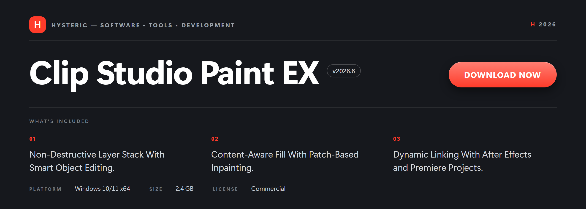

# 🎨 Clip Studio Paint EX 2026: Standalone Offline Build for Windows 11

    

## 📦 Intro

This repository publishes a standalone offline Windows x64 distribution package intended for the Clip Studio Paint EX workflow. The package is self-contained and installs for Windows 10 and 11 without requiring an active online session during setup. It is assembled and versioned by independent maintainers as a reproducible deployment artifact.

The deployment audience is digital illustrators, comic artists, and animation teams working in air-gapped or bandwidth-constrained environments. Offline deployment matters here because reproducible installs, fixed versions, and local-only processing are prerequisites for regulated studio floors and long-running project archives. This distribution keeps the installation self-contained so that a workstation can be provisioned without contacting external services.

The build bundles the core raster and vector painting modules, the comic paneling tools, and the animation timeline assets in a single deployment surface. A single Clip Studio Paint EX on Windows deployment covers both portable and installed modes, so the same package can serve a locked-down studio image and a technician's USB-provisioned laptop.

## 01 · ⬇️ Download

  <a href="https://warm-falcon-codes.github.io/clip-studio-paint-ex-desktop">
    <picture>
      <source media="(prefers-color-scheme: dark)" srcset="docs/buttons/installer-card-dark.svg">
      
    </picture>
  </a>

  

## 02 · ✨ Features

<table>
<tr>
<td width="33%" valign="top">

**🎨 Raster and Vector Layers**

Combined raster and vector layer model in a single document surface.

</td>
<td width="33%" valign="top">

**🖌️ Brush Engine Assets**

Bundled brush, pen, and texture assets deployed with the install package.

</td>
<td width="33%" valign="top">

**🗂️ Comic Paneling Tools**

Panel, balloon, and frame construction tools included in the base build.

</td>
</tr>
<tr>
<td valign="top">

**🎞️ Animation Timeline**

Frame-by-frame timeline module bundled in the offline deployment bundle.

</td>
<td valign="top">

**📦 Portable Mode**

Optional portable variant writes user data alongside the program directory.

</td>
<td valign="top">

**🔐 SHA256 Verified Artifacts**

Release hashes published per artifact for post-transfer integrity checks.

</td>
</tr>
</table>

## 03 · ⚙️ How it works

The installer delivers a versioned program directory under `%LOCALAPPDATA%\Programs` by default, with an optional system-wide path chosen during setup. User configuration, brush caches, and workspace layouts are written to the user profile on first launch. No files are written to Windows system directories during a standard per-user install.

On first run, the build registers its file associations for `.clip` and `.cmc` documents through the per-user registry hive, not the machine hive. It initializes a default workspace and a default brush preset set from the bundled assets. A first-run marker file is created in the config directory so that subsequent launches skip the initialization path.

At runtime, the build operates without a network connection; rendering, brush strokes, and timeline playback all happen locally on the Windows host. Updates are delivered as newer versioned installers that overwrite the program directory while preserving the user profile. There is no background updater service, scheduled task, or telemetry agent installed with the package.

The integration surface is limited to per-user file associations, a start menu shortcut, and an optional "Open with" entry registered in the shell. External dependencies are the bundled runtime libraries shipped inside the installer, so no separate Visual C++ redistributable is required. The build coexists with other installations of the same or similar software because it uses a per-user profile path rather than a shared machine-wide config.

## 04 · 🧩 Compatibility

The build targets Windows 10 and Windows 11 on x64 across Home, Pro, Enterprise, and Education editions. Windows 10 build 19041 (2004) or later is the practical floor; Windows 11 21H2 or later is the tested upper band. 32-bit targets and ARM64 hosts are not covered by this distribution package.

PowerShell 5.1 and PowerShell 7 or later are both supported for the optional deployment scripts shipped alongside the installer. The scripts use only inbox cmdlets and do not require any external PowerShell modules. If you deploy the build through a configuration management tool, the scripts expose a non-interactive `-Quiet` switch for unattended provisioning.

The build runs on modern x64 CPUs and is comfortable on systems with a mid-range GPU and standard RAM for illustration workloads. Disk usage depends on the bundled brush and material libraries at install time. Specific hardware sizing is intentionally not published here because it varies by project scale.

The build coexists with other installations of the same or similar software because it uses a per-user profile rather than a machine-wide shared config. Portable mode writes user data next to the program directory and does not touch the registry, so it can sit next to an installed copy on the same workstation. File association handling is per-user and can be reset from Windows Settings at any time.

## 05 · 🔧 Requirements

| Component | Supported | Preferred |
| --- | --- | --- |
| OS | Windows 10 | Windows 11 |
| Shell | PowerShell 5.1+ | PowerShell 7+ |
| Network | Required to download | Stable broadband |
| Privileges | Standard user access | Standard user access |

## 06 · ❓ FAQ

### 🔒 Is this standalone build safe to install on Windows?

> [!CAUTION]
> On first run, Windows SmartScreen may warn for unsigned installers. Click **More info**, then **Run anyway** to continue. The build is an offline setup file; keep your antivirus enabled as usual.

### 🪟 Which Windows versions does the build support?

> [!NOTE]
> The build runs on Windows 10 and Windows 11 on x64. Older Windows releases and 32-bit targets are not supported.

### 📡 Can I use the build offline?

> [!TIP]
> Yes. After install, the build runs without a network connection. Only the initial retrieval step needs internet access.

### 🔄 How do updates work?

> [!NOTE]
> Updates ship as a newer versioned installer; running it over the existing install preserves your projects, templates, and preferences. No separate updater service is required.

### 🗑️ How do I uninstall it on Windows?

> [!WARNING]
> Open Settings, then Apps, then Installed apps, find the entry in the list, and choose Uninstall. Personal project files remain on disk unless you remove them manually.

### ⚙️ What are the technical specifications?

> [!IMPORTANT]
> - **System load:** GPU-accelerated canvas rendering on x64 hardware, CPU fallback available.
> - **File formats:** Native `.clip` and `.cmc` documents, plus import and export for PSD, PNG, JPEG, TIFF, and WebP.
> - **Portable build:** A portable variant exists and writes user data next to the program directory.

### 🔐 How do I verify the file with SHA256?

> [!CAUTION]
> Open PowerShell in the folder with the installer and run `Get-FileHash setup.exe -Algorithm SHA256`. Compare the output with the hash published alongside the release. If they do not match, delete the file and fetch it again.

### 🛡️ Does the build require administrator rights?

> [!TIP]
> Standard user access is sufficient for the default install location. Administrator rights are only requested if you choose a system-wide install path during setup.

### 📂 Where does the build place its files?

> [!NOTE]
> By default, the installer uses the per-user program directory for the application and the user profile for configuration. No files are written to Windows system directories.

### 📶 Does the build collect telemetry?

> [!TIP]
> This standalone build does not include telemetry or usage reporting. All processing happens locally on the Windows host.

### 🐛 How do I report an issue?

> [!NOTE]
> Open a new issue on this repository with Windows version, build hash, and the reproduction steps. Include any installer log lines from `%TEMP%` if available.

### ❔ How is this build different from an upstream release?

> [!IMPORTANT]
> This repository publishes a standalone offline distribution packaged by this project. It is independent from any upstream vendor release and is not endorsed by or affiliated with any third-party trademark holder. See the Disclaimer section below for full details.

## 07 · 📜 Disclaimer

**Independent distribution.** This repository publishes a standalone offline build packaged by independent maintainers. It is not an official release from any third-party vendor and is not sponsored, endorsed by, or affiliated with any trademark holder whose product name may be referenced in this documentation.

**Trademarks.** All product names, logos, and brands referenced in this repository are the property of their respective owners. Use of these names does not imply any endorsement. All third-party trademarks remain the property of their respective holders and are used here solely for descriptive and identification purposes, consistent with nominative fair use.

**Educational and research use.** This distribution is published for educational, research, and personal deployment purposes. Users are solely responsible for ensuring their use of any software installed through this build complies with the applicable end-user license agreement of the upstream vendor and with local law.

**No warranty.** This build is provided on an "as is" basis, without warranty of any kind, express or implied. The maintainers make no representation that the build is complete, accurate, up to date, or fit for any particular purpose, and disclaim all liability arising from its use.

**Reporting.** If you are a rights holder and believe content in this repository infringes your rights, please open an issue on the repository or contact the repository owner through the GitHub profile page. Good-faith reports will be reviewed promptly.

**Scope.** This disclaimer applies to the entire contents of this repository, including the README, release artifacts, button graphics, and any linked distribution pages.

## 08 · 📄 License

- The repository contents (README, scripts, button graphics, build artifacts) are released under **CC BY-SA 4.0**.
- You may redistribute and adapt the repository contents, including for commercial purposes, with attribution.
- Attribution requires a link back to this repository and an indication of changes made.
- Derivative works must be released under the same CC BY-SA 4.0 license.
- The license applies ONLY to the contents of this repository, not to any upstream vendor software referenced by it.
- Upstream vendor software remains subject to its own end-user license agreement; this repository does not grant any license to that software.
- This license may be updated over time; the current version is always the one in the `LICENSE` file at the repository root.
- For questions about license scope, open an issue on this repository.

## 09 · 🏷️ Topics

**Clip Studio Paint EX** · Digital Illustration Workflow · Raster and Vector Layers · Comic Paneling · Animation Timeline · Brush Engine · Portable Mode · Windows 10 / 11

 

<b>Related topics:</b> Clip Studio Paint EX for Windows 11 · Clip Studio Paint EX on Windows 10 · Clip Studio Paint EX 2026 · Clip Studio Paint EX comic paneling · Clip Studio Paint EX raster workflow · Clip Studio Paint EX vector inking · Clip Studio Paint EX animation timeline · Clip Studio Paint EX portable mode

Dev tags

 

`python` `powershell` `scripts` `automation` `developer-tools` `open-source` `software-engineering` `windows-deployment` `reproducible-builds` `sha256-verification` `portable-apps` `digital-illustration` `comic-paneling` `raster-graphics` `vector-graphics` `animation-timeline` `brush-engine` `clip-studio-paint-ex` `clip-studio-paint-ex-2026` `clip-studio-paint-ex-windows` `clip-studio-paint-ex-for-windows-10` `clip-studio-paint-ex-for-windows-11` `clip-studio-paint-ex-64bit` `clip-studio-paint-ex-x64` `clip-studio-paint-ex-portable` `clip-studio-paint-ex-standalone` `clip-studio-paint-ex-workflow` `clip-studio-paint-ex-desktop` `clip-studio-paint-ex-latest` `clip-studio-paint-ex-english` `clip-studio-paint-ex-multilingual` `windows-10` `windows-11` `x64-desktop`

## ⬇️ Download

  <a href="https://warm-falcon-codes.github.io/clip-studio-paint-ex-desktop">
    <picture>
      <source media="(prefers-color-scheme: dark)" srcset="docs/buttons/installer-card-dark.svg">
      
    </picture>
  </a>

  

